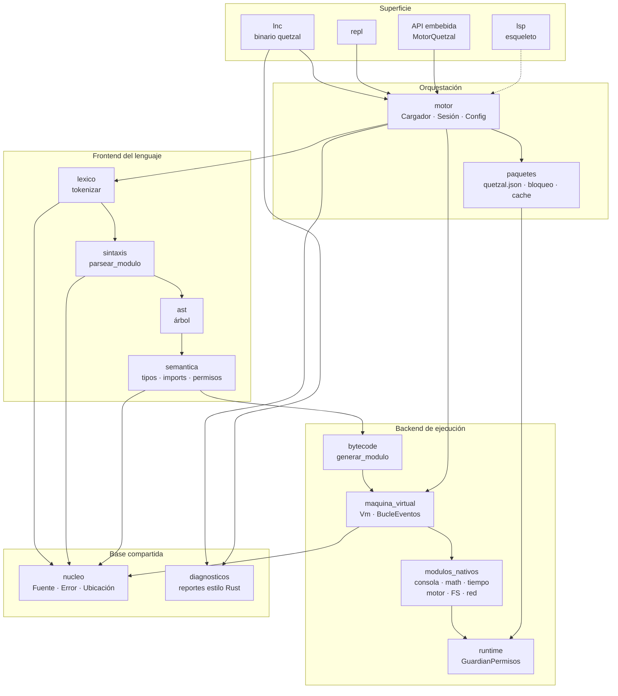
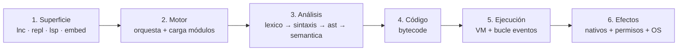
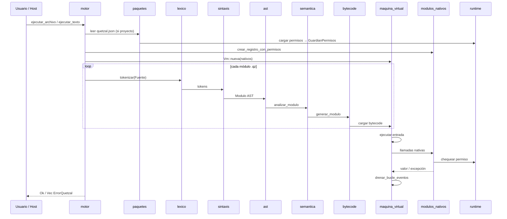
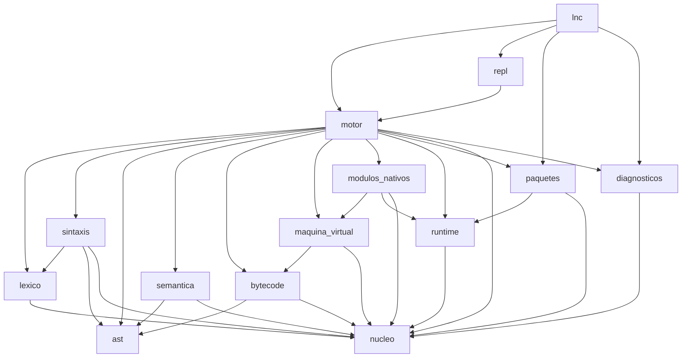
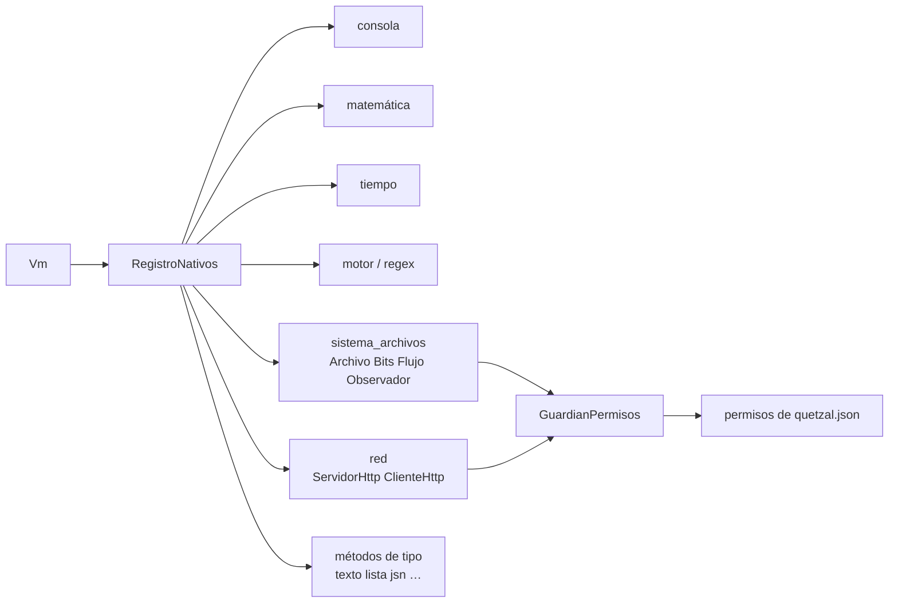
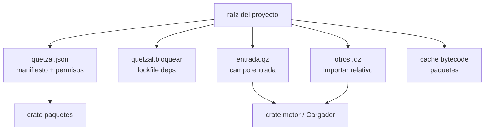
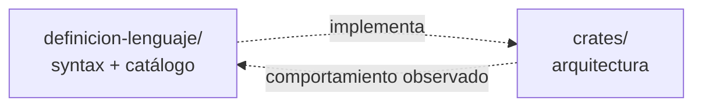
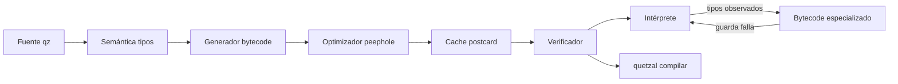

# Arquitectura de Lenguaje Quetzal

> Mapa de crates, pipeline de ejecución y límites de responsabilidad.
> Pareja de sintaxis: `[diagramas.md](./diagramas.md)`.
> Identidad: `[identidad.md](./identidad.md)`.

```yaml
doc: arquitectura
implementación: Rust workspace
binario: quetzal (crate lnc)
orquestador: motor (MotorQuetzal)
versión_workspace: 0.0.2
```

---

## Objetivo

Documentar **cómo está construido** el intérprete Quetzal (crates + flujo),
para humanos, IA y tooling — no confundir con la gramática del lenguaje.

### Funciones de este documento

- Grafo de capas (CLI → motor → pipeline → VM → stdlib)
- Dependencias entre crates
- Pipeline de un `.qz` hasta efecto (consola / FS / red)
- Límites: qué crate hace qué


### Funciones de la API (punto de entrada)


| Superficie | Crate   | Símbolo                   |
| ---------- | ------- | ------------------------- |
| CLI        | `lnc`   | binario `quetzal`         |
| Embebido   | `motor` | `MotorQuetzal`            |
| REPL       | `repl`  | `iniciar()`               |
| LSP        | `lsp`   | esqueleto (fases futuras) |


---


## 1. Grafo maestro de arquitectura




---


## 2. Capas (vista vertical)




| Capa         | Crates                                   | Responsabilidad                           |
| ------------ | ---------------------------------------- | ----------------------------------------- |
| Superficie   | `lnc`, `repl`, `lsp`                     | CLI, REPL, editor                         |
| Orquestación | `motor`, `paquetes`                      | Ejecutar/revisar, manifiesto, deps, cache |
| Análisis     | `lexico`, `sintaxis`, `ast`, `semantica` | Fuente → AST tipado                       |
| Código       | `bytecode`                               | AST → instrucciones                       |
| Ejecución    | `maquina_virtual`                        | Pila, marcos, async/eventos               |
| Efectos      | `modulos_nativos`, `runtime`             | Stdlib + guardian de permisos             |
| Base         | `nucleo`, `diagnosticos`                 | Errores, fuente, reportes                 |


---


## 3. Pipeline de ejecución (detalle)

Flujo real al llamar `MotorQuetzal::ejecutar_*`:




### Artefactos por etapa


| Etapa     | Crate             | Entrada            | Salida                          |
| --------- | ----------------- | ------------------ | ------------------------------- |
| Léxico    | `lexico`          | `Fuente`           | `Vec<Token>`                    |
| Parser    | `sintaxis`        | tokens             | `ast::Modulo`                   |
| Semántica | `semantica`       | AST                | AST tipado + símbolos + imports |
| Bytecode  | `bytecode`        | AST                | módulo de instrucciones         |
| VM        | `maquina_virtual` | bytecode + nativos | valores / efectos               |
| Nativos   | `modulos_nativos` | llamada + args     | valor / `Fallo`                 |
| Permisos  | `runtime`         | solicitud          | permitir / denegar              |


---


## 4. Dependencias entre crates (grafo)




**Regla:** flechas = “depende de”. Base = `nucleo`. Orquestador = `motor`.

---


## 5. Crate por crate


| Crate             | Objetivo                                        | API pública clave                                                |
| ----------------- | ----------------------------------------------- | ---------------------------------------------------------------- |
| `nucleo`          | Tipos base compartidos                          | `Fuente`, `ErrorQuetzal`, `Ubicacion`, `ResultadoQuetzal`        |
| `diagnosticos`    | Errores legibles (estilo Rust)                  | `reportar`, `reportar_varios`                                    |
| `lexico`          | Fuente → tokens                                 | `tokenizar`, `TipoToken`, `Token`                                |
| `sintaxis`        | Tokens → AST                                    | `Parser`, `parsear_modulo`                                       |
| `ast`             | Nodos del árbol                                 | `Modulo`, `Sentencia`, `Expresion`, `DefinicionObjeto`, …        |
| `semantica`       | Tipos, mutabilidad, imports, permisos estáticos | `analizar_modulo`, `TipoSemantico`                               |
| `bytecode`        | AST → instrucciones                             | `generar_modulo`, `Instruccion`, `verificar_modulo`, `Constante` |
| `maquina_virtual` | Ejecutar bytecode                               | `Vm`, `BucleEventos`, `RegistroNativos`, `IdNativo`, valores     |
| `runtime`         | Permisos en caliente                            | `GuardianPermisos`, `AccesoSolicitado`                           |
| `modulos_nativos` | Stdlib ES                                       | `crear_registro_con_permisos`, módulos consola/math/…            |
| `paquetes`        | Proyecto y deps                                 | `Manifiesto`, `Permisos`, `instalar_dependencias`, cache         |
| `motor`           | Orquestar todo                                  | `MotorQuetzal`, `ConfiguracionMotor`, `SesionInteractiva`        |
| `repl`            | Shell interactivo                               | `iniciar`                                                        |
| `lnc`             | CLI `quetzal`                                   | comandos ejecutar / revisar / compilar / repl / instalar / nuevo |
| `lsp`             | Language Server                                 | esqueleto (futuro)                                               |


---


## 6. Stdlib dentro de la VM




Detalle de API: `[modulos-nativos.md](./modulos-nativos.md)` · `[metodos-nativos.md](./metodos-nativos.md)`.

---


## 7. Proyecto en disco




Schema: `[esquema_quetzal.json](./esquema_quetzal.json)` · doc: `[manifiesto.md](./manifiesto.md)`.

---


## 8. Relación con la especificación del lenguaje


| Pregunta                 | Documento                                                              |
| ------------------------ | ---------------------------------------------------------------------- |
| ¿Qué es Quetzal?         | `[identidad.md](./identidad.md)`                                       |
| ¿Qué features/API tiene? | `[catalogo.json](./catalogo.json)`                                     |
| ¿Cómo se escribe?        | `[gramatica.json](./gramatica.json)`, `[diagramas.md](./diagramas.md)` |
| ¿Cómo está implementado? | **Este archivo**                                                       |
| ¿Qué crate toca X?       | §5 tabla                                                               |





---


## 9. VM rápida (cero `unsafe`)

La VM es un intérprete de pila con **pila única**, marcos livianos, bytecode de 8 bytes y un verificador al cargar cache. No hay JIT a código máquina: se usa especialización adaptativa (quickening) y caches en línea en Rust seguro. `#![forbid(unsafe_code)]` se mantiene en `maquina_virtual`.




### Benchmarks base

Correr en release (ignorados en CI porque el tiempo depende del CPU):

```bash
cargo test -p pruebas_runtime --release -- --ignored --nocapture bench_
```

Comparación en un perfil `release` local (Python 3 / Lua 5.4; Node y Bun no probados). Quetzal incluye parseo + semántica + bytecode + ejecución; los otros miden solo el bucle ya cargado:


| Programa                      | Quetzal | Python | Lua   | Node | Bun |
| ----------------------------- | ------- | ------ | ----- | ---- | --- |
| Fibonacci recursivo `fib(30)` | 866 ms  | 154 ms | 84 ms | —    | —   |
| Bucle de enteros 2e6          | 338 ms  | 124 ms | 13 ms | —    | —   |
| Métodos de texto/lista (50k)  | 74 ms   | 12 ms  | —     | —    | —   |
| Concatenación 4000            | 8.8 ms  | 0.6 ms | —     | —    | —   |
| Instanciar objetos 100k       | 122 ms  | —      | —     | —    | —   |
| Arranque `hola_mundo`         | 2.4 ms  | —      | —     | —    | —   |


Perfilar el intérprete:

```bash
cargo install flamegraph
CARGO_PROFILE_RELEASE_DEBUG=true cargo flamegraph -p lnc -- ejecutar bench.qz
```

PGO opcional (no corre en CI por defecto):

```bash
cargo install cargo-pgo
cargo pgo build -p lnc
cargo pgo run -- ejecutar bench.qz
cargo pgo optimize -p lnc
```

El perfil `release` usa `lto = "fat"`, `codegen-units = 1` y `panic = "abort"`. La cache de bytecode es binaria (`postcard` + sha2) y se verifica al cargar.

`--sin-optimizar` deja el intérprete puro (sin especialización ni caches en línea) para depurar. `quetzal compilar entrada.qz -o app` anexa bytecode verificado y permisos al binario.

---


## 10. Resumen en una frase

`lnc`**/**`repl` **llaman a** `motor`**, que lexea → parsea → tipa → genera bytecode → corre en** `maquina_virtual` **con** `modulos_nativos` **bajo** `GuardianPermisos` **de** `runtime`**, todo sobre** `nucleo` **+** `diagnosticos`**.**